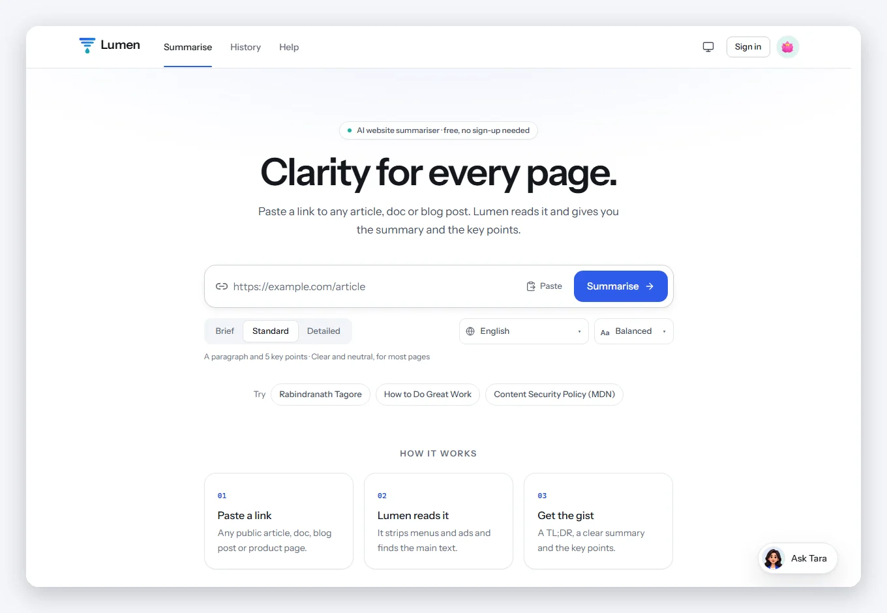
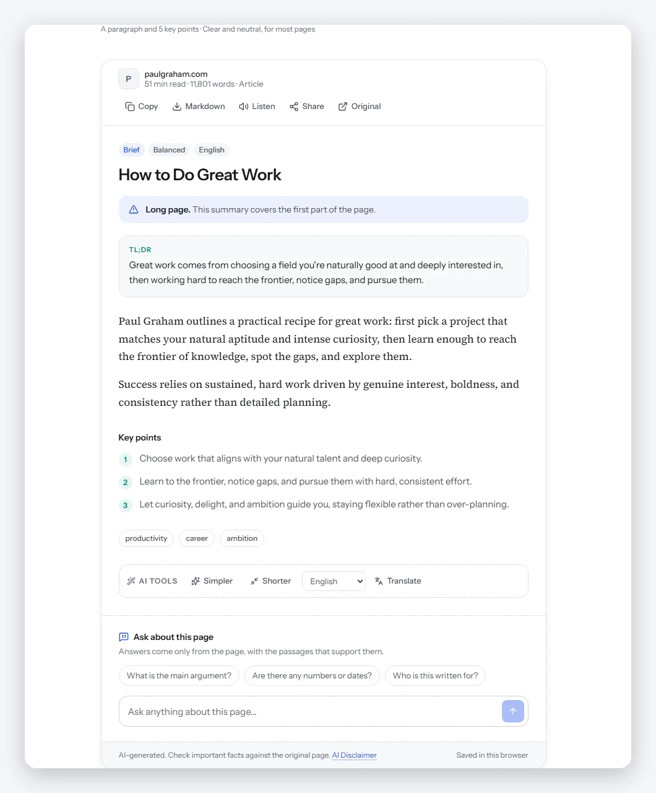
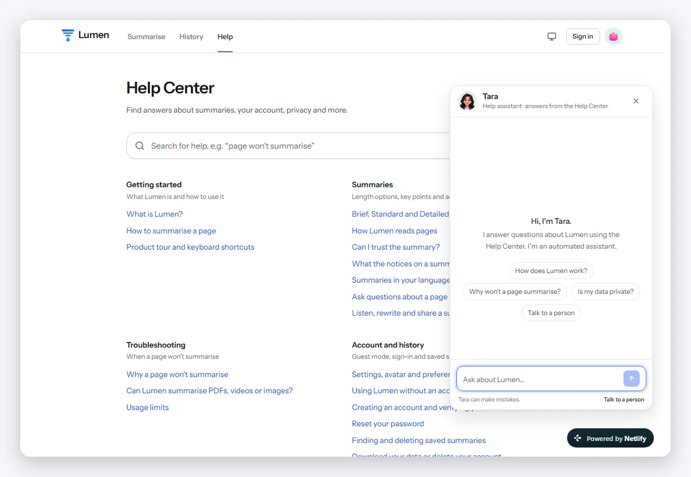
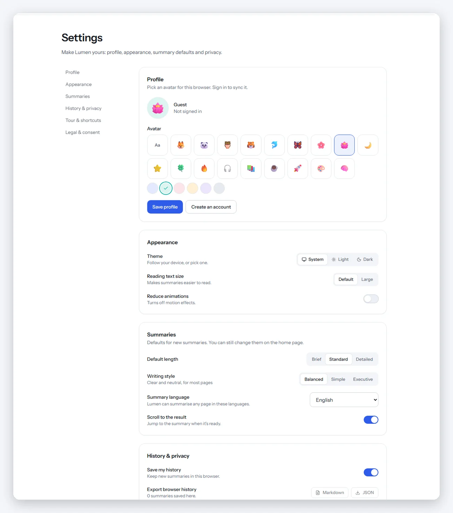
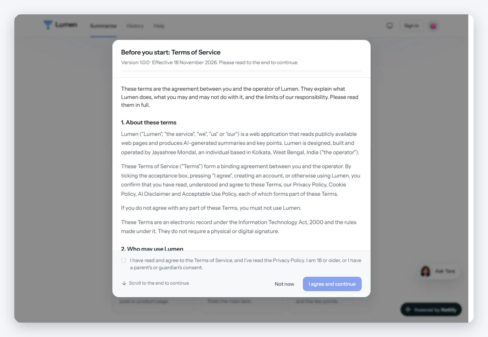
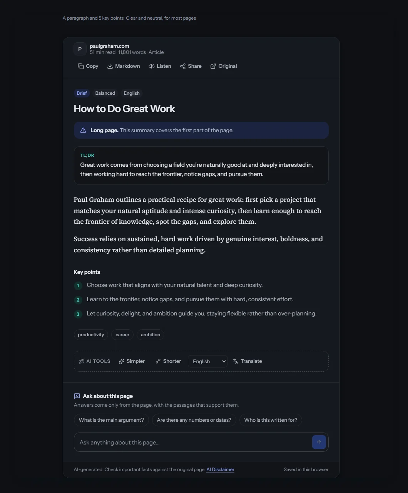
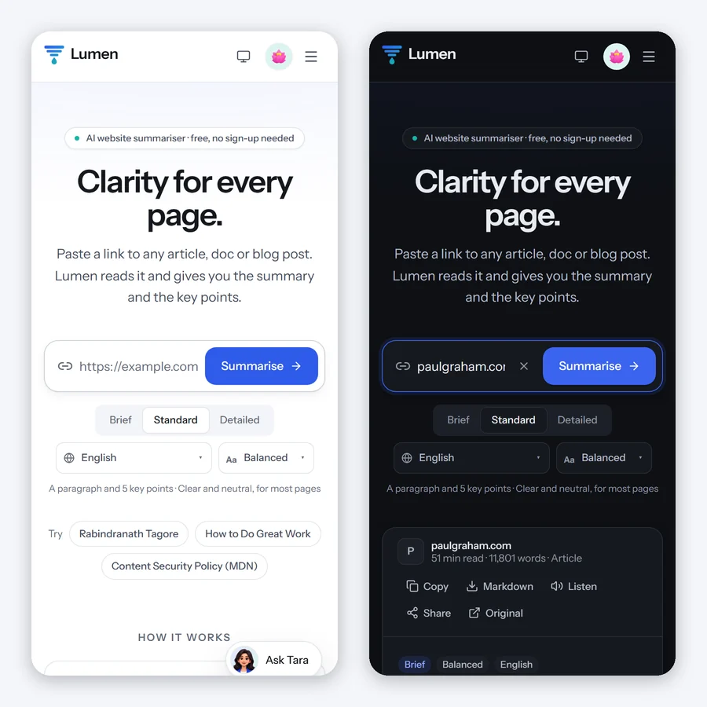
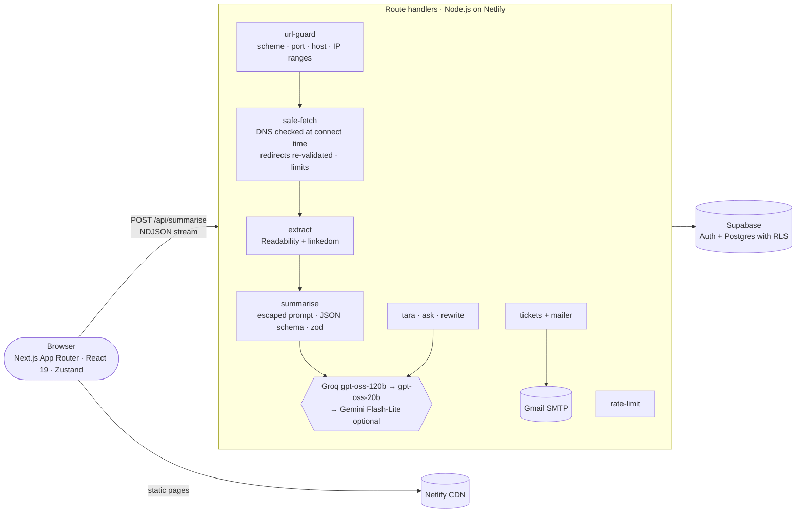
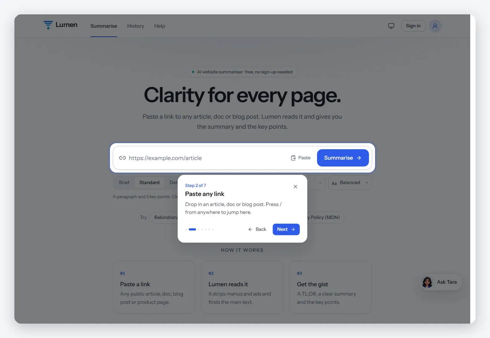
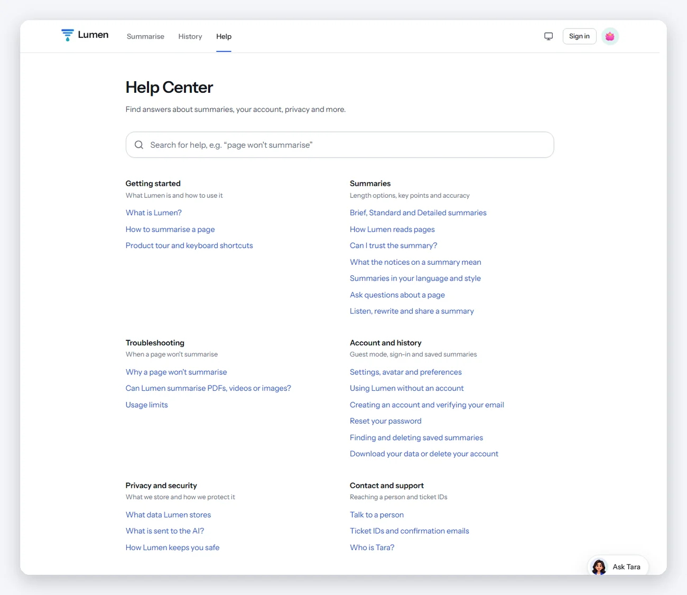

<div align="center">


# Lumen

### Clarity for every page.

Paste a link. Lumen reads the page and gives you a TL;DR, a clear summary and the key points,<br>
then lets you ask follow-up questions that are answered **only from the page**, with quotes to prove it.

<p>
  <a href="https://lumen-ai-summariser.netlify.app"></a>
</p>

<p>
  
  
  
  
  
  
  
</p>
<p>
  
  
  
  
  
</p>

**[Open the live app →](https://lumen-ai-summariser.netlify.app)** &nbsp;·&nbsp; [Features](#features) &nbsp;·&nbsp; [Architecture](#architecture) &nbsp;·&nbsp; [How AI is used](#how-ai-is-used) &nbsp;·&nbsp; [Security](#security) &nbsp;·&nbsp; [Quality](#quality-and-testing) &nbsp;·&nbsp; [Run locally](#run-locally)

Designed &amp; built by **Jayashree Mondal**, Kolkata, India

<br>



</div>

---

## At a glance

| | |
| --- | --- |
| **What it is** | A production-quality AI website summariser built for INT. First Flush, Assignment 1. |
| **Try it** | [lumen-ai-summariser.netlify.app](https://lumen-ai-summariser.netlify.app): no sign-up needed (guest mode), or create an account to sync history. |
| **Highlights** | Live streamed progress · 16 output languages · grounded Q&A with verified quotes · one-tap rewrite · read aloud · Ask Tara help assistant with support tickets · full legal pack for India's DPDP Act |
| **Engineering** | Server-side fetching with SSRF protection · strict JSON AI output validated with zod · prompt-injection defences · row-level security · rate limits · static pages from a CDN |
| **Quality** | 132 unit tests · 22 end-to-end tests on the live site · 69 automated security checks · Lighthouse accessibility 100 and SEO 100 |

## Features

<table>
<tr>
<td width="50%" valign="top">

### Summaries you can trust
- Paste any public article, doc or blog post (typing `example.com/post` is fine).
- **Brief, Standard or Detailed**, in **16 languages** (English, Hindi, Bengali, Tamil, Telugu, Marathi, Gujarati, Kannada, Malayalam, Punjabi, Urdu, Spanish, French, German, Japanese, Arabic) and **3 styles** (Balanced, Simple, Executive).
- Real progress streamed from the server: fetching → finding the main content → writing.
- TL;DR, summary, numbered key points, topics, reading time and word count.
- Clear notices for long pages, thin pages and pages that try to manipulate AI.

</td>
<td width="50%"></td>
</tr>
<tr>
<td width="50%"></td>
<td width="50%" valign="top">

### Ask, rewrite, listen
- **Ask about this page:** answers come only from the page, with up to three supporting quotes that Lumen checks word for word against the page text.
- **AI tools:** make any summary **simpler**, **shorter**, or **translate** it, then switch back to the original.
- **Listen** (browser speech), **Copy**, **Markdown** download and **Share**.
- **Ask Tara:** a help assistant that answers only from the in-app Help Center (25 articles) and hands over to a person with a support ticket and a branded confirmation email.

</td>
</tr>
<tr>
<td width="50%" valign="top">

### Built like a product
- **Guest mode** for everything; **accounts** (email + password with verification) sync history.
- **Settings:** emoji avatar, theme, larger reading text, reduced motion, default length, language and style, history on or off, export and clear data.
- **First-time tour** with a spotlight, skippable and replayable.
- **History** with search and reading stats; recent summaries on the home page.
- Skeleton loaders, instant press feedback, keyboard shortcut `/`, light and dark themes, fully responsive.

</td>
<td width="50%"></td>
</tr>
<tr>
<td width="50%"></td>
<td width="50%" valign="top">

### Legal and privacy, done properly
- **Terms of Service** with scroll-to-accept; every acceptance is stored with the document version.
- **Privacy Policy** for India's **DPDP Act, 2023** (Data Fiduciary, Grievance Officer, rights, retention, processors), plus **Cookie Policy**, **AI Disclaimer** and **Acceptable Use Policy**.
- Download-my-data and delete-my-account for signed-in users.
- No ads, no analytics, no trackers; raw IP addresses are never stored.

</td>
</tr>
</table>

<div align="center">


</div>

## Architecture



| Layer | Choice | Why |
| --- | --- | --- |
| Framework | Next.js 16 (App Router) + TypeScript (strict) | Route handlers keep keys on the server; pages are prerendered and served from the CDN. |
| UI | Tailwind CSS 4 with CSS-variable design tokens, lucide icons | One token set drives light and dark themes; no UI kit to fight. |
| State | Zustand with `persist` | Small, explicit stores: request lifecycle, guest history, preferences, consent. |
| AI | Vercel AI SDK, `@ai-sdk/groq`, optional `@ai-sdk/google` | Structured output with schema validation and a provider fallback chain. |
| Extraction | `@mozilla/readability` + `linkedom` | Proven article extraction without a heavy browser DOM. |
| Backend | Supabase Auth + Postgres | Verified email auth, row-level security, SQL migrations. |
| Email | Nodemailer + Gmail SMTP | Transactional ticket emails from the operator's own address. |
| Hosting | Netlify | Git-based deploys, Next.js runtime, CDN. |

### Request flow for a summary
1. The browser checks the input and, the first time, asks the visitor to accept the Terms.
2. `/api/summarise` checks origin, body size and schema, normalises the URL and applies rate limits.
3. The page is fetched with a guarded DNS lookup; every redirect is validated again.
4. Readable text is extracted and trimmed at a paragraph boundary if it is very long.
5. The model returns JSON that must pass the schema; otherwise the next model is tried.
6. The result streams back; signed-in users' summaries are saved (RLS), guests' stay in the browser.

## How AI is used

**In the product**
- **Summaries.** The page's readable text (up to ~16,000 characters), its URL, title, the chosen length, language and style go to `openai/gpt-oss-120b` on Groq, which must return a fixed JSON shape: `title`, `tldr`, `summary`, `keyPoints`, `topics`, `contentType`, `quality`, `injectionDetected`. `openai/gpt-oss-20b` is the second choice; Google's free-tier `gemini-2.5-flash-lite` is used only if configured and both fail.
- **Two layers of validation.** The AI SDK validates against a zod schema, then Lumen applies stricter rules (trimming, limits, de-duplication). Invalid output moves to the next model.
- **Ask about this page.** The model may answer only from the page, must say when the page doesn't cover the question, and returns short supporting quotes. Lumen keeps a quote only if it appears in the page text (normalised for case, spacing and punctuation), so invented evidence is dropped.
- **Rewrite.** Simpler, shorter and translated versions are generated from the summary alone and validated with the same schema.
- **Ask Tara.** Keyword retrieval selects Help Center articles; the model answers only from those and returns the article IDs it used, which are checked. Greetings, "talk to a person" and questions with no matching article are handled without the model.
- **Prompt-injection defences.** Untrusted text (pages, questions, summaries) is HTML-escaped and wrapped in data tags so it cannot close or forge the prompt structure; hidden bidi and zero-width characters are removed; instructions say the content is data; output must match a schema and is never rendered as HTML.
- **Privacy.** Names, emails, account IDs and IP addresses are never sent to an AI provider.

**In making Lumen**
- The **logo concept** and the **Tara character art** were created with AI image-generation tools. The logo was redrawn by hand as a clean SVG (`scripts/build-brand.mjs` generates every icon and the social image from it), and the Tara poses were cut out with the open-source `rembg` model (`scripts/tara_cutouts.py`).

## Security

- **SSRF protection.** Only `http`/`https` on ports 80 and 443; no credentials in URLs; local, internal and single-label host names refused; private, loopback, link-local (incl. cloud metadata `169.254.169.254`), CGNAT, multicast, reserved and documentation ranges blocked for IPv4 and IPv6 (incl. IPv4-mapped, NAT64, 6to4, and decimal/hex/octal IPv4 forms). DNS is checked inside the socket's `lookup`, so DNS rebinding can't bypass it, and every redirect is re-validated.
- **Resource limits.** 9 s fetch timeout, 5 redirects, 3 MB decompressed body (zip-bomb safe), HTML and plain text only.
- **Secrets stay on the server.** Keys are read only in `server-only` modules; the browser gets only the Supabase URL and publishable key, which are public by design and protected by RLS.
- **Headers.** Content-Security-Policy (`default-src 'self'`, `object-src 'none'`, `frame-ancestors 'none'`, `base-uri`/`form-action 'self'`, `connect-src` limited to the app and Supabase), HSTS, `nosniff`, `Referrer-Policy`, `Permissions-Policy`, `Cross-Origin-Opener-Policy`. Pages are static, so the CSP allows inline scripts that Next.js needs; user content is never rendered as HTML.
- **Input validation and CSRF.** Every API body is size-limited and parsed with zod; cross-origin POSTs are rejected; the auth callback only redirects to paths on the site.
- **Rate limits** (Postgres-backed): summaries 6/min and 60/day; page questions 10/min and 120/day; rewrites 10/min and 120/day; Tara 10/min and 150/day; tickets 3/hour per IP and 5/day per email.
- **Email safety.** All user text is HTML-escaped; header values are stripped of line breaks; honeypot, time trap, link and keyword checks stop spam.
- **Database.** Row-level security on every table; users read and delete only their own rows; tickets, consents and rate limits are written only by the server.

## Quality and testing

| Suite | Result |
| --- | --- |
| Unit tests (Vitest): URL guard and SSRF, safe fetch against a real local server, extraction, AI output validation, prompt escaping, quote verification, ticket emails, Help Center retrieval | **132 / 132 passing** |
| End-to-end (Playwright) **on the live site** with a real model: summary, rewrite, ask, Tara, tickets, tour, settings, legal, headers, bundle secrets, axe accessibility on 6 pages, mobile | **22 / 22 passing** |
| Security check on the live site: headers, 27 SSRF probes, validation, CSRF, authorisation, open redirect, secrets in the bundle | **69 / 69 passing** |
| Lighthouse, live (Performance · Accessibility · Best practices · SEO) | Home mobile 92 · 100 · 96 · 100 · Home desktop 98 · 100 · 96 · 100 · Help and Terms mobile 94 · 100 · 96 · 100 |
| `npm audit --omit=dev` | 0 known vulnerabilities in production dependencies |

Commands, per-test results and the full numbers are in [`docs/TESTING.md`](docs/TESTING.md).

<details>
<summary><strong>Issues that testing caught, and how they were fixed</strong></summary>

- **Slow pages (1.2–8 s).** A per-request CSP nonce forced every page to render on the server. Pages are now static and served from the CDN (under 1 s measured from Kolkata).
- **Hydration error only on Netlify.** Netlify injects a comment and whitespace into `<head>` on free sites; the layout no longer renders explicit `<head>` children, so injected nodes can't break hydration. Reproduced by replaying the injected HTML.
- **Ask Tara hidden behind Netlify's badge.** The badge is measured at runtime and floating UI moves above it.
- **Auth redirect to an internal host.** Behind the CDN the request URL can be an internal deploy host; the callback now redirects to the public site URL.
- **Plain-text pages crashed extraction.** Plain text is now handled without a DOM.

</details>

## Design choices

- **Calm, neutral interface** with the logo's two colours as accents: cobalt `#2F5BEA` for actions, teal `#12B5A6` for highlights.
- **Typography first:** Instrument Sans for the interface, Source Serif 4 for summary text, so a summary reads like an article.
- **Honest progress:** the steps are real server stages, not a timer.
- **Errors you can act on:** 17 error types, each with its own title, explanation and next step.
- **Accessible by default:** landmarks, skip link, visible focus, labelled controls, `aria-live` regions, keyboard-operable controls and dialogs, reduced motion, AA contrast in both themes.
- **Tara, used sparingly:** on the help launcher, in the assistant, the Help Center, the tour and the 404 page.

<div align="center">


</div>

## Run locally

```bash
git clone https://github.com/jayashreemondal2005/lumen-ai-summariser.git
cd lumen-ai-summariser
npm install
cp .env.example .env.local   # fill in Groq, Supabase and SMTP values
npm run dev                  # http://localhost:3000
```

**Database:** in Supabase open **SQL Editor → New query** and run the files in [`supabase/migrations/`](supabase/migrations) in order (`20261118000000_lumen_schema.sql`, then `20261118120000_language_style.sql`). Both are safe to run more than once.

```bash
npm test                                   # unit tests
npm run build && npm run test:e2e          # end-to-end against a local production build
node scripts/security-check.mjs <url>      # black-box security check
```

**Deploy (Netlify):** import the repository, then *Site configuration → Environment variables → Import from a .env file*. In Supabase, set *Authentication → URL Configuration* (Site URL and `https://<site>/**` redirect).

## Project structure

```
src/
  app/                 pages and API route handlers
    api/summarise      streaming summary endpoint
    api/ask            questions about a page
    api/rewrite        simpler, shorter or translated summaries
    api/tara           help assistant
    api/tickets        support tickets
    api/consent        Terms acceptance records
    api/summaries      saved history (owner only)
    api/account        data export and account deletion
  components/          summariser, summary view, Tara, tour, settings, legal, auth
  lib/
    server/            url-guard, safe-fetch, extract, ai, summarise, mailer, rate-limit
    legal/             Terms, Privacy, Cookies, AI Disclaimer, Acceptable Use
    help-center.ts     Help Center articles and search
supabase/migrations/   SQL schema with RLS
scripts/               brand assets, screenshots, security check
tests/                 unit and end-to-end tests
docs/                  testing results and screenshots
```

## Roadmap

- PDF and image-heavy page support
- Browser extension ("summarise this tab")
- Shareable public summary pages
- Team workspaces with shared history

## Author

**Jayashree Mondal**, Kolkata, India · [GitHub @jayashreemondal2005](https://github.com/jayashreemondal2005)

Designed &amp; built by Jayashree Mondal for the INT. First Flush programme.

## License

[MIT](LICENSE) © 2026 Jayashree Mondal. The Lumen name, logo and the Tara character are not covered by the code licence.
