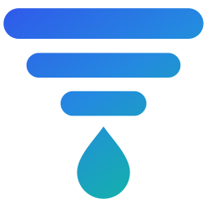

<p align="center">
  
</p>

<h1 align="center">Lumen</h1>
<p align="center"><strong>Clarity for every page.</strong><br>
An AI website summariser: paste a link, get a TL;DR, a clear summary and the key points.</p>

<p align="center">
  <a href="https://lumen-ai-summariser.netlify.app"><strong>Live app</strong></a> ·
  <a href="#features">Features</a> ·
  <a href="#architecture">Architecture</a> ·
  <a href="#how-ai-is-used">How AI is used</a> ·
  <a href="#security">Security</a> ·
  <a href="#testing">Testing</a>
</p>

<p align="center">Designed &amp; built by <strong>Jayashree Mondal</strong>, Kolkata, India · INT First Flush, Assignment 1</p>

---

## Overview

Lumen takes the URL of any public web page, fetches it safely on the server, extracts the readable article text, and asks an AI model for a structured summary. The result is validated against a strict schema before it reaches the screen. Guests can use every core feature; accounts add history that follows you across devices.

A help assistant, **Ask Tara**, answers questions using only Lumen's Help Center and hands over to a person (a support ticket with an emailed ticket ID) when she can't help.

## Features

**Summariser**
- URL input that accepts what people type (`example.com/post`, full URLs, trailing spaces) with instant client-side checks.
- Three lengths: Brief, Standard, Detailed.
- Live progress streamed from the server: fetching, finding the main content, writing the summary.
- Result: title, TL;DR, summary, numbered key points, topic tags, reading time and word count.
- Copy as text, download as Markdown, open the original.
- Notices when a page was truncated, had little readable text, or contained hidden instructions aimed at AI.
- Clear loading, empty and error states, with specific messages and a retry for every failure type.

**Accounts and guest mode**
- Guest mode: everything works without signing up; history is kept in the browser (up to 50 items).
- Email and password accounts with email verification (Supabase Auth), password reset, and optional Google sign-in.
- Cloud history with search and delete; owner-only row-level security.
- Account page: download my data (JSON) and delete my account.

**Ask Tara and support**
- Answers grounded only in the in-app Help Center (20 articles), with links to the articles used.
- Escalation to a support ticket. The ticket is stored in Postgres and emailed to the support inbox; the user gets a branded confirmation email with the logo, a greeting, the app link and their ticket ID.
- Anti-spam: rate limits per IP and per email, a honeypot field, a minimum fill time, link-count and keyword checks. All user text is HTML-escaped in emails and stripped of line breaks in headers.

**Legal pack** (operator: Jayashree Mondal, Kolkata, India)
- Terms of Service with scroll-to-accept, plus a consent record that stores the document version.
- Privacy Policy written for India's DPDP Act, 2023 (Data Fiduciary, Grievance Officer, rights, retention, processors, transfers).
- Cookie Policy, AI Disclaimer and Acceptable Use Policy.

## Architecture

```
Browser (Next.js App Router, React 19, Zustand)
   │  POST /api/summarise  (NDJSON stream of stages, then the result)
   ▼
Next.js route handlers on Netlify (Node.js runtime)
   ├─ url-guard.ts     scheme / port / host checks, private-IP blocking
   ├─ safe-fetch.ts    DNS checked at connect time, redirects re-validated, size + time limits
   ├─ extract.ts       Mozilla Readability on linkedom, structural fallback
   ├─ summarise.ts     escaped prompt, Groq via Vercel AI SDK, strict JSON + zod
   │                    (gpt-oss-120b → gpt-oss-20b → Gemini Flash-Lite if configured)
   ├─ tara.ts          Help Center retrieval → grounded answer (same model chain)
   ├─ tickets + mailer Gmail SMTP, branded HTML emails
   └─ rate-limit.ts    Postgres fixed-window counter (in-memory fallback)
   │
   ▼
Supabase: Auth (email + password, Google) and Postgres
   summaries · tickets · consents · rate_limits   (RLS on every table)
```

| Layer | Choice | Why |
| --- | --- | --- |
| Framework | Next.js 16 (App Router) + TypeScript | Server route handlers keep keys off the client; one deployable unit. |
| Styling | Tailwind CSS v4 with CSS-variable design tokens | Light and dark themes from one set of tokens; no UI kit to fight. |
| State | Zustand (+ `persist`) | Small, explicit stores: request state, guest history, consent. |
| AI | Vercel AI SDK, `@ai-sdk/groq`, optional `@ai-sdk/google` | Structured output with schema validation and provider fallback. |
| Extraction | `@mozilla/readability` + `linkedom` | Proven article extraction without a heavy DOM. |
| Backend | Supabase Auth + Postgres | Verified email auth, row-level security, SQL migrations. |
| Email | Nodemailer + Gmail SMTP | Simple, reliable transactional email from the operator's own account. |
| Hosting | Netlify | Git-based deploys, Next.js runtime, environment import from a `.env` file. |

## Design choices

- **Calm, neutral interface.** Neutral surfaces with two accents taken from the logo: cobalt `#2F5BEA` for actions and teal `#12B5A6` for highlights. No decorative gradients behind content.
- **Typography does the work.** Instrument Sans for the interface and Source Serif 4 for the summary text, so a summary reads like an article, not a dashboard.
- **Honest progress.** The loading state shows real server stages streamed as they happen, not a timer.
- **Errors you can act on.** Each failure type (blocked address, 403, timeout, PDF, no readable text, AI busy, rate limit) has its own title, explanation and next step.
- **Accessible by default.** Semantic landmarks, a skip link, visible focus rings, labelled controls, `aria-live` regions for progress and results, keyboard-operable length picker and dialogs, reduced-motion support, and WCAG AA colour contrast in both themes.
- **Tara, used sparingly.** She appears on the help launcher, in the assistant, on the Help Center and on the 404 page, and nowhere else.
- **Logo.** The mark (three bars narrowing into a drop: many words distilled into one clear idea) is a hand-made SVG redrawn from an AI-generated concept; every icon size and the social image are generated from that one SVG (`scripts/build-brand.mjs`).

## How AI is used

**In the product**
- **Summaries.** The server sends the page's readable text (up to about 16,000 characters), its URL, title and the chosen length to an AI model and asks for a fixed JSON shape: `title`, `tldr`, `summary`, `keyPoints`, `topics`, `contentType`, `quality` and `injectionDetected`. The default model is `openai/gpt-oss-120b` on Groq, with `openai/gpt-oss-20b` as a second choice. Google's free-tier `gemini-2.5-flash-lite` is used only if `GEMINI_API_KEY` is set and both Groq models fail.
- **Validation.** The AI SDK validates the response against a zod schema, and Lumen validates it again with stricter rules (trimming, length limits, de-duplication). If a model returns something invalid, the next model in the chain is tried.
- **Ask Tara.** A small keyword retriever picks the most relevant Help Center articles; the model may answer only from those articles and must return the IDs it used, which are checked against the articles it was given. Greetings, "talk to a person" and questions with no matching article are handled without calling the model.
- **Prompt-injection defences.** Page text and user questions are escaped (`<`, `>`, `&`) and wrapped in data tags, so they cannot close or forge the prompt structure; invisible bidirectional and zero-width characters are removed; the instructions tell the model to treat that content strictly as data; output must match the schema; and nothing the model returns is rendered as HTML.
- **What is not sent.** Names, email addresses, account IDs and IP addresses are never sent to an AI provider.

**In making Lumen**
- The **logo concept** and the **Tara character art** were created with AI image-generation tools. The logo was then redrawn by hand as a clean SVG, and the Tara poses were cut out with the open-source `rembg` background-removal model (`scripts/tara_cutouts.py`).

## Security

- **SSRF protection.** Only `http`/`https` on ports 80 and 443; no credentials in URLs; local, internal and single-label host names are refused; literal and resolved IP addresses are checked against private, loopback, link-local (including cloud metadata `169.254.169.254`), CGNAT, multicast, reserved and documentation ranges for IPv4 and IPv6 (including IPv4-mapped, NAT64 and 6to4 forms). The DNS check runs inside the socket's `lookup`, so DNS rebinding cannot bypass it, and every redirect is re-validated.
- **Resource limits.** 9 s fetch timeout, 5 redirects, 3 MB decompressed body cap (zip-bomb safe), HTML and plain text only.
- **Secrets stay on the server.** API keys are read only in `server-only` modules; the browser bundle contains only the Supabase URL and anon key, which are public by design and protected by RLS.
- **Headers.** Nonce-based Content-Security-Policy with `strict-dynamic`, `frame-ancestors 'none'`, HSTS, `X-Content-Type-Options`, `Referrer-Policy`, `Permissions-Policy` and `Cross-Origin-Opener-Policy`.
- **Input validation.** Every API body is size-limited and parsed with zod; POST routes reject cross-origin requests.
- **Rate limits.** Summaries 6/min and 60/day per user or hashed IP; Tara 10/min; tickets 3/hour per IP and 5/day per email.
- **Privacy.** Raw IP addresses are never stored, only a salted SHA-256 hash.
- **Database.** Row-level security on every table. Users can read and delete only their own rows; tickets, consents and rate limits are written only by the server.

## Testing

See [`docs/TESTING.md`](docs/TESTING.md) for commands and results. In short: unit tests (Vitest) for URL validation and SSRF, extraction, AI output validation, prompt escaping and ticket emails; a Playwright end-to-end suite; Lighthouse; and a security check of headers, SSRF probes and dependencies.

## Running locally

```bash
npm install
cp .env.example .env.local   # then fill in the values
npm run dev                  # http://localhost:3000
```

Database: open Supabase, **SQL Editor → New query**, paste [`supabase/migrations/20261118000000_lumen_schema.sql`](supabase/migrations/20261118000000_lumen_schema.sql) and run it.

```bash
npm test          # unit tests
npm run test:e2e  # end-to-end tests (starts the app)
npm run build     # production build
```

## Deploying to Netlify

1. Import the GitHub repository in Netlify (build command `npm run build`, publish directory `.next`; both come from `netlify.toml`).
2. Site configuration → Environment variables → **Import from a .env file**, and paste the production values.
3. Deploy, then set Supabase **Authentication → URL Configuration**: Site URL = the Netlify URL, and add `https://<site>.netlify.app/**` to Redirect URLs.

## Project structure

```
src/
  app/                 pages and API route handlers
    api/summarise      streaming summary endpoint
    api/tara           help assistant
    api/tickets        support tickets
    api/consent        Terms acceptance records
    api/summaries      saved history (owner only)
    api/account        data export and account deletion
  components/          UI (summariser, Tara, ticket form, legal, auth)
  lib/
    server/            server-only code: url-guard, safe-fetch, extract, ai, mailer, rate-limit
    legal/             Terms, Privacy, Cookies, AI Disclaimer, Acceptable Use
    help-center.ts     Help Center articles and search
supabase/migrations/   SQL schema with RLS
scripts/               brand asset generation
tests/                 unit and end-to-end tests
```

## Limitations and next steps

- Pages that render their text with JavaScript, sit behind a login or paywall, or are PDFs can't be summarised yet.
- Very long pages are summarised from their first ~16,000 characters (Lumen says so on the result).
- Next: PDF support, summaries in Indian languages, a browser extension, and shareable summary links.

## Credits

Designed &amp; built by **Jayashree Mondal**, Kolkata, India.

## License

[MIT](LICENSE) © 2026 Jayashree Mondal. The Lumen name, logo and the Tara character are not covered by the code licence.
